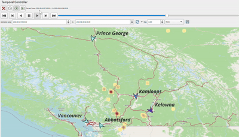

# Wildfire AQI

## Demo



Collect wildfire hotspot data and hourly air-quality and weather data for cities in British Columbia (BC), Canada. The pipeline stores the data in PostgreSQL with PostGIS and supports spatial visualization and map overlays in QGIS.

The current cities are Vancouver, Kamloops, and Kelowna. The pipeline uses NASA FIRMS VIIRS SNPP NRT hotspot data and the Open-Meteo air-quality and weather APIs.

## Features

- Fetch NASA FIRMS hotspots within the BC bounding box.
- Fetch hourly PM2.5, US AQI, wind speed, and wind direction for three cities.
- Fetch either the most recent 1–5 days or an inclusive, user-specified date range.
- Store observations and point geometries in PostGIS. Re-running a query updates existing records using city/time or hotspot location/time keys.
- Connect to the PostGIS tables from QGIS for visualization.

## Prerequisites

### 1. NASA FIRMS API key

This project uses the FIRMS Area API to retrieve VIIRS SNPP NRT data and requires a `MAP_KEY`:

1. Request a MAP_KEY from the [NASA FIRMS Area API](https://firms.modaps.eosdis.nasa.gov/api/area/).
2. Add the key to `FIRMS_API_KEY` in your local `.env` file.
3. Never commit `.env`, API keys, or database passwords to GitHub.

FIRMS currently documents a default limit of 5,000 transactions per 10-minute interval. Multi-day requests may count as multiple transactions. Check the [FIRMS API documentation](https://firms.modaps.eosdis.nasa.gov/api/area/) for the latest limits.

### 2. PostgreSQL and PostGIS

Set up a PostgreSQL server with PostGIS installed and enabled. Create a database (for example, `wildfire_aqi`), connect to it, and run [`sql/schema.sql`](sql/schema.sql).

For example, using `psql`:

```bash
psql -h localhost -U postgres -d wildfire_aqi -f sql/schema.sql
```

Running `CREATE EXTENSION postgis` may require a database administrator or a role with permission to install extensions. The application creates unique indexes at startup, but it does **not** create the tables; run the schema first.

### 3. Python and configuration

Python 3.10 or later is required. Create a virtual environment in the project directory and install the dependencies.

#### Linux / WSL

```bash
cd /path/to/wildfire_aqi
python3 -m venv .venv
source .venv/bin/activate
python -m pip install -r requirements.txt
cp .env.example .env
```

#### Windows PowerShell

```powershell
cd path\to\wildfire_aqi
py -3 -m venv .venv
.\.venv\Scripts\Activate.ps1
python -m pip install -r requirements.txt
Copy-Item .env.example .env
```

If PowerShell blocks the activation script, you can run Python without activating the environment by using `.venv\Scripts\python.exe` for Python and pip commands. Create a separate virtual environment for Windows and WSL; do not share one `.venv` between them.

Edit `.env` and provide your database connection details and FIRMS key:

```dotenv
DB_HOST=localhost
DB_PORT=5432
DB_NAME=wildfire_aqi
DB_USER=postgres
DB_PASSWORD=your_local_database_password
FIRMS_API_KEY=your_FIRMS_MAP_KEY
```

`.env` is listed in `.gitignore`. Commit only `.env.example`, never real credentials.

## Usage

Run the following commands from the project root using the Python environment where the requirements are installed.

### Fetch recent data

```bash
python main.py
```

To specify 1–5 recent days:

```bash
python main.py --days 3
```

### Fetch a specific date range

Both `--start` and `--end` are required and inclusive. Do not combine them with `--days`.

```bash
python main.py --start 2026-09-18 --end 2026-09-20
```

### Show command-line options

```bash
python main.py --help
```

On success, the application prints the number of FIRMS hotspots and hourly air-quality/weather observations stored. The database tables are:

- `wildfire_hotspots`: FIRMS coordinates, brightness, acquisition time, confidence, and PostGIS point geometry.
- `aqi_stations`: city coordinates, PM2.5, US AQI, wind speed, wind direction, observation time, and PostGIS point geometry.

The `aqi_stations.aqi_level` column stores the numeric US AQI returned by the API. `recorded_at` and hotspot acquisition times are stored as UTC/GMT timestamps. If a fetch or database operation fails, the command exits with an error. Since records are written across multiple operations, a failure may leave partial results in the database; rerunning the command updates records with matching unique keys.

## View and map data in QGIS

1. Create the database schema and run a successful data fetch.
2. In QGIS, create a PostgreSQL/PostGIS connection using the host, port, database, and user from your `.env` configuration.
3. Load `public.wildfire_hotspots` and `public.aqi_stations`. Both use the `geom` geometry column and EPSG:4326.
4. Style or filter the layers by `confidence`, `brightness`, `aqi_level`, or `recorded_at`, then combine them with basemaps or other geographic layers.
5. When publishing results, include a map image, legend, analysis dates, data sources, and any required attribution.

This repository includes [`wildfire.qgz`](wildfire.qgz). Before sharing it, check in QGIS that the project does not contain machine-specific data paths or saved database credentials. Add future map exports to `docs/images/` and include them here with captions and methodology.

## Data sources and attribution

- [NASA FIRMS](https://firms.modaps.eosdis.nasa.gov/): VIIRS SNPP NRT wildfire hotspots.
- [Open-Meteo Air Quality API](https://open-meteo.com/en/docs/air-quality-api): PM2.5 and US AQI.
- [Open-Meteo Weather Forecast API](https://open-meteo.com/en/docs): wind speed and direction.

The Open-Meteo data collected by this application are model data and should not be described as ground-station measurements. Historical data availability and the nature of the model data depend on the API. When interpreting or publishing results, state the dates, sources, and relevant limitations. The Open-Meteo air-quality documentation requests attribution to Open-Meteo and the CAMS ENSEMBLE data providers; follow the attribution requirements in the [API documentation](https://open-meteo.com/en/docs/air-quality-api).

## GitHub publishing checklist

- Confirm `.env`, database passwords, and API keys are not tracked by Git.
- Do not commit `.venv/`; users should create their own environment from `requirements.txt`.
- Review the QGIS project data sources and ensure no credentials are saved in the project.
- Only publish map images, videos, or other outputs that you intend to share. Label results with their dates and data sources.
- After creating a GitHub repository, initialize or push this local project using the instructions provided by GitHub. This project directory has not yet been initialized as a Git repository.
